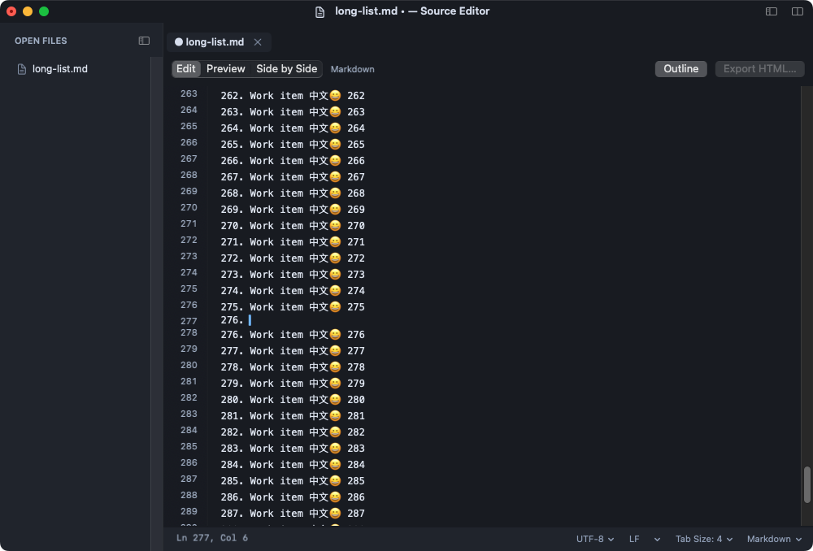

# OpenSourceEditor

[中文](README.zh-CN.md) · [Documentation](docs/README.md) · [Release notes](RELEASE_NOTES.md)

A native desktop editor for code, everyday text and Markdown notes. The macOS application is named **Source Editor** and uses Swift/AppKit; an experimental Windows edition uses C++/Win32. Build the editor directly from this repository, without Electron, npm, a Sublime Text installation or the original investigation workspace.

**Current macOS version: 0.9.10 · macOS 13+ · Apple Silicon and Intel Universal builds.** Windows has a smaller feature set and still needs native GUI validation.



## Get started

### macOS

Install Apple's Xcode Command Line Tools if needed (`xcode-select --install`), then:

```sh
git clone https://github.com/ziqi-wlb/OpenSourceEditor.git
cd OpenSourceEditor
bash scripts/install_macos.sh universal
```

The script builds both architectures, installs to `~/Applications/Source Editor.app`, registers Finder **Open With** associations and launches the app. Quit any running copy with **⌘Q** before an update. The installer preserves the previous installation and leaves the default file association unchanged.

To build without installing or create a ZIP:

```sh
bash build.sh --arch universal
open '.build/Source Editor.app'
bash package.sh universal
```

Use `--arch arm64` or `--arch x86_64` for a single architecture. Packaging produces `.build/SourceEditor-<version>-macos-universal.zip`; unpack it and move **Source Editor.app** to Applications. Current distribution builds are ad hoc signed for local execution, without Developer ID signing or notarization. Downloaded builds may require the normal macOS Finder **Open** approval flow.

Python 3 is optional for build commands/extensions and required for the test drivers. The editor's core text, Markdown and image features use system frameworks.

### Windows (experimental)

Install Visual Studio Build Tools with **Desktop development with C++** and a Windows SDK. From an **x64 Native Tools Command Prompt** at the repository root:

```powershell
powershell -ExecutionPolicy Bypass -File windows/build.ps1
```

Run `windows/.build/SourceEditor.exe`. It is a portable x64 application for Windows 10/11, with no installer or file associations. See [Windows build instructions and limitations](windows/README.md), including optional cross-compilation with an already installed Zig toolchain.

## What it supports

| Area | macOS | Windows experimental edition |
| --- | --- | --- |
| Editing | File tabs, multiple selections, undo/redo, line/comment commands, indentation and basic syntax colors | File tabs, Unicode editing, native undo and basic indentation |
| Search | File literal/regex find and replace; background project literal search | Literal forward search and F3 |
| Projects | Lazy folder tree, active-file reveal, create/move/rename/trash and file-event updates | Lazy folder tree and project-row context menu |
| Layout | Independent left/right or top/bottom splits, grouped window tabs, focus mode and hideable sidebar/tabs/status/gutters | One editor area with file tabs |
| Markdown and notes | Edit/Preview/Side by Side, one-click Outline, HTML export, note templates, task/list continuation and image attachments | Opens Markdown as text |
| Images | Read-only raster tabs, Fit/100%/zoom, metadata and mixed image/text splits | Image preview not implemented |
| File settings | Encoding/BOM, LF/CRLF/CR, syntax, tabs/spaces, tab width, fonts and dark/light themes | UTF-8/BOM, UTF-16 LE BOM, LF/CRLF, tabs/spaces and dark/light text |
| Persistence | Recent folders/files, previous workspace, explicit sessions and independent draft recovery | Workspace/draft restoration not implemented |
| Extensions | Explicit build commands and a limited one-shot Python SDK | Extension host not implemented |

See the [feature matrix](docs/features.md) for detailed coverage. This is an independent implementation inspired by familiar editor interactions; it does not promise Sublime Text or VS Code plugin compatibility.

### Daily workflows

- **Notes:** Markdown preview uses the current unsaved buffer. **Outline** opens rendered preview directly; **Export HTML…** writes a styled page. Templates, checkboxes and list continuation support work notes.
- **Unfinished edits:** **Keep Drafts** stores a separate backup without overwriting originals. Restart restores retained buffers; **Discard Drafts** or **Revert File…** returns to disk content. Native undo history does not survive process restart.
- **Projects:** A folder-only window starts with a home page. Selecting a project file expands and follows its sidebar location. Click the top file title to enter a complete name or path temporarily.
- **Windows and panes:** New macOS workspaces group into native window tabs under one Dock icon. Split panes can display different files or share one document with independent selections and scrolling.
- **Files:** Text, file tabs and project rows have context menus, including path copying and reveal actions. Saves check for external disk changes and use atomic replacement.

## Useful macOS shortcuts

| Action | Shortcut |
| --- | --- |
| New workspace window / close file tab | ⇧⌘N / ⌘W |
| Find / project search | ⌘F / ⇧⌘F |
| Toggle Markdown preview / side by side | ⇧⌘V / ⌥⌘V |
| Split editor / focus next pane / keep one pane | ⌥⌘2 / ⌥⌘3 / ⌥⌘1 |
| Toggle sidebar / focus mode | ⌃⌘B / ⌥⌘Z |
| Enter file name or path in the title | ⌥⌘O |
| Toggle comment / duplicate line / delete line | ⌘/ / ⇧⌘D / ⇧⌘K |

In Focus Mode, Escape in the source editor restores the previous layout. Move to the screen's top edge to access the macOS menu bar in full screen.

For command-line opening:

```sh
'.build/Source Editor.app/Contents/MacOS/source-editor' --project . README.md
'.build/Source Editor.app/Contents/MacOS/source-editor' --help
'.build/Source Editor.app/Contents/MacOS/source-editor' --version
```

## How it works

`EditorAppDelegate` coordinates application/window lifetime; each workspace owns its documents and commands. `EditorDocument` owns text storage, encoding, disk identity, dirty state and undo. Split panes share storage while keeping separate TextKit layout managers and viewports.

TextKit lays out text on demand. The document shares line/lexical caches across panes, and highlights are painted near the viewport. Custom edits replace the changed UTF-16 span, preserve unchanged layout and reveal the caret. Search, Markdown rendering, image decoding and draft writes use bounded background work with identity/revision checks.

Foundation parses Markdown into escaped HTML; the system WebKit renders preview on demand. ImageIO handles bounded raster previews. Drafts and workspace metadata are separate from source files. Python extensions run only when selected and have the current user's permissions; the host is not a sandbox.

```text
Sources/               Native macOS editor and shared document operations
Resources/             Release metadata, configuration examples and Python SDK
windows/               Separate native C++/Win32 implementation
scripts/               Icon generation, installation, packaging support and source export
tests/                 Core, document, UI and resource checks
docs/                  English/Chinese architecture, features and implementation guides
.github/workflows/     macOS Universal and Windows x64 build jobs
```

Read [architecture](docs/architecture.md), [draft recovery](docs/draft-recovery.md), [extensions](plugins.md) and [performance reports](PERFORMANCE.md) for design details and measured limits.

## Development and validation

Run checks matching the change. For typing/viewport changes:

```sh
python3 tests/run_tests.py typing-check --suite typing --ui --arch universal
```

For documentation changes:

```sh
python3 tests/check_documentation.py
python3 scripts/generate_release_notes.py --check
```

`--ui` requires a logged-in macOS desktop and temporarily activates test windows. Broader validation is available with `--suite full`; it is not required for every small edit. Release and test applications have separate identities. Artifacts, fixtures and backups stay in ignored `.build/` directories.

The 0.9.10 focused run passed **167 checks** across core editing, document settings, native typing and splits. It is not a full-suite pass: a broader run retained two Markdown UI failures involving divider dragging and heading-link navigation. Intel version entry was checked under Rosetta; physical Intel GUI and Windows GUI validation remain open. See [typing stability and executed scope](docs/typing-stability.md). The workflow files configure GitHub builds; their presence does not establish a successful cloud run.

LSP, richer grammar/snippet engines, rectangular selection, integrated terminal/Git tooling, project regex/replace and full extension compatibility remain future work. Markdown math/Mermaid/PDF, automatic updates, Developer ID signing/notarization, prolonged IME/accessibility and large-project acceptance also need work. See [development and contribution](docs/development.md) and [readiness plan](docs/product-readiness.md).

## Contribute and contact

Use [GitHub Issues](https://github.com/ziqi-wlb/OpenSourceEditor/issues) for reproducible bugs and feature requests, or open a pull request. Include the OS/architecture, app version, reproduction steps and checks actually run. Preserve unsaved content and update both language versions of changed guides.

Author: [ziqi-wlb](https://github.com/ziqi-wlb) · [550461053@qq.com](mailto:550461053@qq.com). The application's **About Source Editor** and **Release Notes…** windows show the same authored information offline.

A license has not yet been selected. Public source availability alone does not grant an open-source license; a license will be added after the project owner chooses it.
