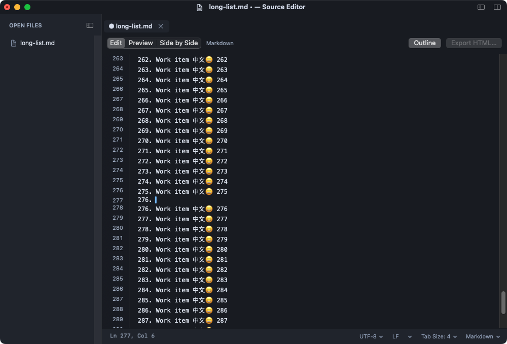

# OpenSourceEditor

[English](README.md) · [文档导航](docs/README.zh-CN.md) · [版本说明](RELEASE_NOTES.zh-CN.md)

面向代码编辑、日常文本和 Markdown 工作笔记的原生桌面编辑器。macOS 应用名为 **Source Editor**，使用 Swift/AppKit；Windows 实验版本使用 C++/Win32。仓库可独立编译，不依赖 Electron、npm、Sublime Text 安装或原始调查工作区。

**当前 macOS 版本：0.9.10 · macOS 13+ · 支持 Apple Silicon 与 Intel Universal 编译。** Windows 功能较少，原生 GUI 验证尚未完成。



## 快速开始

### macOS

如尚未安装 Apple Xcode Command Line Tools，先执行 `xcode-select --install`，然后：

```sh
git clone https://github.com/ziqi-wlb/OpenSourceEditor.git
cd OpenSourceEditor
bash scripts/install_macos.sh universal
```

脚本编译两个架构，安装到 `~/Applications/Source Editor.app`，注册 Finder“打开方式”并启动。更新前请用 **⌘Q** 正常退出已有副本。安装器备份旧版，不修改默认文件关联。

仅编译或生成 ZIP：

```sh
bash build.sh --arch universal
open '.build/Source Editor.app'
bash package.sh universal
```

单架构可使用 `--arch arm64` 或 `--arch x86_64`。打包输出为 `.build/SourceEditor-<版本>-macos-universal.zip`，解压后将 **Source Editor.app** 移入 Applications。当前构建使用本地运行所需的 ad hoc 签名，没有 Developer ID 签名或公证；下载版本可能需要通过 macOS Finder“打开”的正常确认流程。

Python 3 仅在选用相关构建命令/扩展及运行测试驱动时需要。核心文本、Markdown 和图片功能使用系统框架。

### Windows（实验版本）

安装 Visual Studio Build Tools 的“使用 C++ 的桌面开发”与 Windows SDK。在 **x64 Native Tools Command Prompt** 中进入仓库根目录：

```powershell
powershell -ExecutionPolicy Bypass -File windows/build.ps1
```

运行 `windows/.build/SourceEditor.exe`。目标为 Windows 10/11 的便携 x64 程序，当前没有安装器或文件关联。另见 [Windows 编译说明和限制](windows/README.zh-CN.md)，包含使用已安装 Zig 工具链交叉编译的方法。

## 支持的功能

| 领域 | macOS | Windows 实验版本 |
| --- | --- | --- |
| 编辑 | 文件标签、多选、撤销重做、行/注释操作、缩进和基础语法配色 | 文件标签、Unicode 编辑、原生撤销和基础缩进 |
| 搜索 | 文件内字面/正则查找替换，后台项目字面搜索 | 字面前向搜索与 F3 |
| 项目 | 懒加载目录、跟随当前文件、创建/移动/重命名/废纸篓与文件事件刷新 | 懒加载目录与项目行右键菜单 |
| 布局 | 左右/上下独立切分、窗口分组、专注模式与侧栏/标签/状态/行号隐藏 | 单编辑区域与文件标签 |
| Markdown 与笔记 | Edit/Preview/Side by Side、一键 Outline、HTML 导出、模板、任务/列表续行和图片附件 | 以文本方式打开 Markdown |
| 图片 | 栅格图片只读标签、Fit/100%/缩放、元信息及图片/文本混合切分 | 未实现图片预览 |
| 文件设置 | 编码/BOM、LF/CRLF/CR、语法、Tab/空格及宽度、字体和深浅主题 | UTF-8/BOM、UTF-16 LE BOM、LF/CRLF、Tab/空格及深浅正文 |
| 持久化 | 最近文件/文件夹、上次工作区、显式会话和独立草稿恢复 | 未实现工作区/草稿恢复 |
| 扩展 | 明确选择的构建命令与有限的一次性 Python SDK | 未实现扩展宿主 |

完整覆盖范围见 [功能矩阵](docs/features.zh-CN.md)。项目独立实现常见编辑器交互，不承诺与 Sublime Text 或 VS Code 的插件兼容。

### 日常使用

- **笔记：** Markdown 渲染当前未保存内容；**Outline** 直接打开预览，**Export HTML…** 导出带样式页面。模板、任务勾选和列表续行用于工作记录。
- **未完成编辑：** **Keep Drafts** 单独备份，不覆盖原文件；重启恢复保留的缓冲区，**Discard Drafts** 或 **Revert File…** 返回磁盘内容。原生撤销历史不跨进程保存。
- **项目：** 仅打开文件夹时展示主页；选中文件自动展开并定位左侧目录。单击顶部文件标题，临时输入完整名称或路径。
- **窗口与切分：** macOS 工作区默认合并为原生窗口标签，共用一个 Dock 图标；切分区域可以打开不同文件，或共享同一文档并保留独立选区和滚动。
- **文件：** 正文、文件标签和项目行提供右键菜单，包含路径复制与定位。保存前检查磁盘外部变化，并原子替换。

## macOS 常用快捷键

| 操作 | 快捷键 |
| --- | --- |
| 新建工作区窗口 / 关闭文件标签 | ⇧⌘N / ⌘W |
| 文件查找 / 项目搜索 | ⌘F / ⇧⌘F |
| 切换 Markdown 预览 / 并排预览 | ⇧⌘V / ⌥⌘V |
| 切分 / 切换区域 / 保留单区域 | ⌥⌘2 / ⌥⌘3 / ⌥⌘1 |
| 显示或隐藏侧栏 / 专注模式 | ⌃⌘B / ⌥⌘Z |
| 在标题处输入文件名或路径 | ⌥⌘O |
| 切换注释 / 复制行 / 删除行 | ⌘/ / ⇧⌘D / ⇧⌘K |

专注模式下，在正文编辑处按 Escape 恢复布局。全屏时将鼠标移到屏幕顶部可访问 macOS 菜单栏。

命令行打开：

```sh
'.build/Source Editor.app/Contents/MacOS/source-editor' --project . README.md
'.build/Source Editor.app/Contents/MacOS/source-editor' --help
'.build/Source Editor.app/Contents/MacOS/source-editor' --version
```

## 实现原理

`EditorAppDelegate` 协调应用和窗口生命周期，每个工作区拥有自己的文档与命令。`EditorDocument` 拥有文本存储、编码、磁盘身份、脏状态和撤销。切分区域共享存储，各自拥有 TextKit 排版管理器和视口。

TextKit 按需排版；文档统一缓存行索引和词法结果，视口附近应用高亮。自定义编辑仅替换变化的 UTF-16 片段，保留其他排版并确保光标可见。搜索、Markdown 渲染、图片解码和草稿写入采用有界后台工作，并检查身份/版本以拒绝过期结果。

Foundation 将 Markdown 解析为转义后的 HTML，系统 WebKit 按需显示预览；ImageIO 提供有界栅格图片预览。草稿和工作区元数据与原文件分开。Python 扩展由用户主动选择执行，拥有当前用户权限，宿主并非沙箱。

```text
Sources/               macOS 原生编辑器与文档操作
Resources/             版本信息、配置例子和 Python SDK
windows/               独立 C++/Win32 实现
scripts/               图标生成、安装、打包辅助和源码导出
tests/                 核心、文档、UI 和资源检查
docs/                  中英文架构、功能及实现指南
.github/workflows/     macOS Universal 与 Windows x64 构建任务
```

详细说明见 [架构](docs/architecture.zh-CN.md)、[草稿恢复](docs/draft-recovery.zh-CN.md)、[扩展](plugins.zh-CN.md) 和 [性能文档](PERFORMANCE.zh-CN.md)。

## 开发与验证

日常改动按影响范围执行检查。例如输入/滚动修改：

```sh
python3 tests/run_tests.py typing-check --suite typing --ui --arch universal
```

文档修改：

```sh
python3 tests/check_documentation.py
python3 scripts/generate_release_notes.py --check
```

`--ui` 需要已登录的 macOS 桌面，会临时激活测试窗口。跨模块或发布时可用 `--suite full`，无需每次小改动重复全套。发布版与测试版拥有独立应用身份，产物、样本和备份保存在忽略的 `.build/` 下。

0.9.10 的核心编辑、文档设置、原生输入和切分专项共 **167 项通过**。这不代表全套通过：一次更广泛运行保留了分割条拖动和渲染标题链接导航两项 Markdown UI 失败。Intel 版本入口在 Rosetta 验证，实体 Intel 和 Windows GUI 尚待验证。详情见 [输入稳定性与执行范围](docs/typing-stability.zh-CN.md)。

2026-10-31 本轮分析重新编译 Universal，**280 项无界面检查通过、13 项明确跳过**。`042ea05` 的[修复 CI](https://github.com/ziqi-wlb/OpenSourceEditor/actions/runs/41200817992)通过 macOS 构建/检查/打包及 Windows MSVC 构建/Unicode 编码执行。产品 UI 复查仍有两项失败，具体问题及完善顺序见[当前差距分析](docs/current-gap-analysis.zh-CN.md)。

LSP、更完整语法/片段引擎、矩形选择、集成终端/Git、项目正则/替换和完整扩展兼容仍是后续工作。Markdown 公式/Mermaid/PDF、自动更新、Developer ID 签名/公证、长期 IME/无障碍及大项目验收也需完善。见 [开发与贡献](docs/development.zh-CN.md) 和 [产品就绪计划](docs/product-readiness.zh-CN.md)。

## 贡献与联系

通过 [GitHub Issues](https://github.com/ziqi-wlb/OpenSourceEditor/issues) 提交可复现问题或功能建议，也欢迎 pull request。请说明系统/架构、应用版本、复现步骤和实际执行的检查；保护未保存内容，同步修改相关中英文文档。

作者：[ziqi-wlb](https://github.com/ziqi-wlb) · [550461053@qq.com](mailto:550461053@qq.com)。应用的 **About Source Editor** 与 **Release Notes…** 窗口离线显示同一来源的信息。

尚未选定许可证。公开源码本身不等于授予开源许可，项目所有者选择后再添加许可证。
