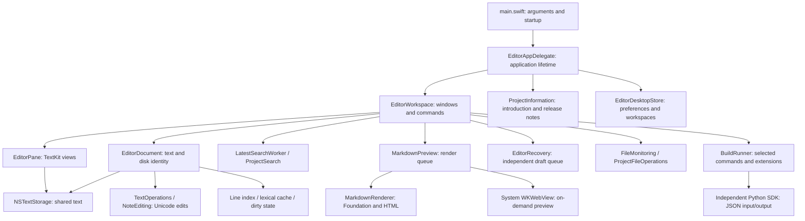

# Source Editor architecture and implementation

[中文](architecture.zh-CN.md)

Source Editor is an independently implemented native text editor. macOS uses Swift, AppKit, TextKit, Foundation and WebKit; Windows uses C++17, Win32 and RichEdit. The application builds from `editor/` alone. Sublime Text, REA, Node.js and the investigation directory are not runtime dependencies. Familiar editor interactions guide feature design; third-party editor binaries, source and icons are excluded from releases.

## Structure

Arrows indicate direct use. Responsibilities are separated by objects, rather than multiple Swift packages. `EditorUI.swift` still contains the workspace controller and several native views; later splitting must preserve clear document, command and resource ownership.

| Boundary | Main sources | Responsibility |
| --- | --- | --- |
| Application | `Sources/main.swift`, `EditorApplication.swift` | Arguments, Finder opening, instance reuse, window grouping and quit coordination |
| Workspace/UI | `EditorUI.swift`, `StatusBar.swift`, `EditorDialogs.swift`, `EditorTheme.swift` | Tabs, project tree, menus, panes, sheets, status, themes and fonts |
| Project information | `ProjectInformation.swift`, `Resources/project-information.json` | App-owned introduction window, language switching, author contact and offline release notes |
| Document/text | `EditorCore.swift`, `DocumentSettings.swift`, `DocumentLineIndex.swift`, `LineEditing.swift` | Shared storage, UTF-16 ranges, undo, edits, encoding, indentation and disk conflicts |
| Lexical rules | `LanguageRules.swift`, `SyntaxHighlights.swift` | Supported syntax and viewport highlighting; not a complete TextMate engine |
| Search/projects | `SearchEngine.swift`, `ProjectSearch.swift`, `ProjectSearchPanel.swift` | Literal/regex file search, project traversal/literal search, cancellation and coverage limits |
| Markdown/notes | `MarkdownRenderer.swift`, `MarkdownPreview.swift`, `NoteEditing.swift`, `NoteAssets.swift` | Foundation parsing, escaped HTML, WebKit, templates, tasks and image attachments |
| Persistence | `DesktopState.swift`, `Session.swift`, `Recovery.swift`, `RecentLocations.swift` | Preferences, workspaces, manual sessions, independent drafts and recent files |
| External files | `FileMonitoring.swift`, `ProjectFileOperations.swift`, `LocalFileData.swift` | FSEvents, disk checks, scoped create/move/trash and bounded reads |
| External work | `EditorServices.swift`, `Resources/plugin_host/` | Explicit commands, timeouts, cancellation, output bounds and limited Python SDK |
| Windows | `windows/main.cpp`, `windows/tests.cpp` | Separate Win32 implementation and encoding tests; fewer features than macOS |

## Documents and presentation

Each `EditorDocument` owns its `NSTextStorage`, disk path/digest, current and disk encoding, settings and undo manager. Tabs retain documents; switching creates the panes required for presentation. Split panes have separate layout managers over the same storage, sharing edits without copying text. The document owns whole-buffer font, paragraph and base foreground styles. Matching styles are reused; character edits or font/paragraph/theme changes invalidate them. Panes own typing attributes, viewports and local highlighting. Reselecting the active tab preserves its view, selections and scroll position.

Text ranges use AppKit UTF-16 `NSRange`. Production edits validate boundaries, reject surrogate splits and update text/selections as one transaction. The document's CR/LF index provides line/column positions; tab columns follow indentation settings. Multi-selection, line edits and Markdown formatting share the transaction path.

TextKit lays out visible content on demand. Documents share line and lexical caches; edits invalidate them, while scrolling consumes computed facts. Highlight colors are applied near the viewport. Whole-buffer edits, font changes and consecutive file opens still incur main-queue work; performance reports state measured limits.

## Opening, saving and recovery

Opening reads bytes, strictly decodes them and records canonical paths, BOM/encoding and SHA-256. Unknown/damaged encodings report errors instead of silently replacing characters. Saving encodes the buffer, rechecks disk digests for external changes and atomically replaces the target. Success updates the baseline; failure retains unsaved text. Native Save As selection, overwrite confirmation and current-file conflicts have distinct entry points.

FSEvents monitors projects and document parents. Coalesced events trigger background disk checks. Clean files can reload; modified or missing files retain their buffers and show Review. Moving project files updates open documents and recent paths; trashing detaches retained buffers from the old path.

Drafts go to application support, leaving originals untouched. Normal close captures the final draft and waits for completion; failure cancels close. Normal restart restores explicitly retained drafts. Changed originals become untitled buffers. See [draft recovery](draft-recovery.md).

## Background work and valid results

File search, project search and Markdown use background tasks. File search debounces and cancels requests; results carry document/query revisions. Replacement requires complete scanning and current content. Project traversal reports skipped files and capacity limits; partial results do not establish complete coverage.

Explicit preview starts immediately; subsequent edits debounce. Foundation owns Markdown blocks, attributes and source positions. The HTML adapter escapes text and constrains links/images. WebKit is created on request and can be released when returning to source. Preview uses unsaved text; Outline and the Markdown build shortcut render directly. Parsed output and matching WebKit navigation are checked separately, rejecting obsolete revisions. See [document workspace](document-workspace.md).

Users explicitly select builds and extensions. The runner owns processes, timeouts, cancellation and output bounds. Returned edits apply only when document identity and revision still match. Plugins run with current-user permissions and are not a general sandbox or full Sublime API implementation. See [extensions](../plugins.md).

## Project information and distribution

The application delegate retains one native information window, outside editor workspace tab groups. It loads authored bilingual metadata on request and offers introduction, release history and author email. Contact opens a draft in the system mail application; it does not send a message. `scripts/generate_release_notes.py` generates both release documents from the same resource, avoiding separate manually maintained histories. No network or WebKit process is needed to read the notes.

The workspace owns normal chrome visibility and a temporary Focus Mode snapshot. Frame layout consumes zero heights for hidden controls. Native fullscreen delegates handle menu/Dock presentation and transition completion/failure; panes consume shared gutter visibility. Workspace persistence records normal preferences and the pre-focus frame. See [layout](layout.md).

`build.sh` compiles production Swift and copies permitted Python/JSON resources. An original Swift drawing generates ICNS sizes; system fonts/icons require no font bundle. Universal builds compile arm64 and x86_64 separately and merge them with lipo. macOS 13 is the minimum. Windows uses MSVC or an installed Zig toolchain; system RichEdit is not bundled.

`--tests` builds a separate application from the same sources with `EDITOR_TESTS`; its bundle declares no document associations. Release checks exclude test symbols, personal paths and caches. Native regressions exercise sheets, menus, views and process exit. A build does not establish another platform's GUI acceptance. See [build/install](../README.md), [features](features.md), [development](development.md) and [performance](performance-optimization.md).

Preferences → Remember Previous Workspace defaults on and restores folders as well as file tabs. Turning it off starts blank while retaining backups for manual recovery and independent recent folder history. See [workspace restoration](workspace-restoration.md).
