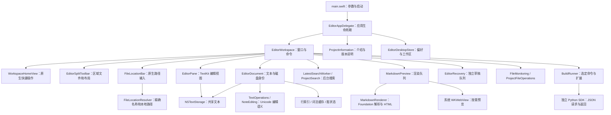

# Source Editor 架构与实现原理

[English](architecture.md)

Source Editor 是独立实现的原生文本编辑器。macOS 使用 Swift / AppKit / TextKit / Foundation / WebKit；Windows 使用 C++17 / Win32 / RichEdit。应用可以从 `editor/` 单独编译，不需要安装 Sublime Text、REA、Node.js，也不需要逆向调查目录。熟悉编辑器的交互用于确定功能目标，发行程序不包含第三方编辑器的二进制、源码或图标。

[文件输入栏](file-location.zh-CN.md) 解析本地路径，并在已有项目索引中匹配完整名称，然后调用文档所有者的正常打开流程。显示跟随活动区域，不拥有文档存储，也不会在输入时扫描目录。

## 系统结构

图中箭头表示直接使用关系。现有代码通过对象职责组织，尚未拆分为多个 Swift Package；`EditorUI.swift` 同时包含工作区控制器和若干原生视图，后续拆分应保持文档、资源和命令的所有权清楚。

| 边界 | 主要源码 | 职责 |
| --- | --- | --- |
| 应用 | `Sources/main.swift`, `EditorApplication.swift` | 启动参数、Finder 打开、复用运行实例、多窗口分组、退出协调 |
| 工作区与 UI | `EditorUI.swift`, `StatusBar.swift`, `EditorDialogs.swift`, `EditorTheme.swift` | 文件页、项目树、菜单、编辑 pane、sheet、状态栏、主题与字体 |
| 项目信息 | `ProjectInformation.swift`, `Resources/project-information.json` | 应用拥有的介绍窗口、中英文、作者邮箱、离线版本历史 |
| 文档与文本 | `EditorCore.swift`, `DocumentSettings.swift`, `DocumentLineIndex.swift`, `LineEditing.swift` | 共享 storage、UTF-16 范围、撤销、编辑事务、编码、缩进和磁盘冲突 |
| 词法 | `LanguageRules.swift`, `SyntaxHighlights.swift` | 支持语法与可见范围高亮；不是完整 TextMate 语法引擎 |
| 搜索与项目 | `SearchEngine.swift`, `ProjectSearch.swift`, `ProjectSearchPanel.swift` | 单文件字面/正则搜索、项目遍历和字面搜索、取消与覆盖限制 |
| Markdown 与笔记 | `MarkdownRenderer.swift`, `MarkdownPreview.swift`, `NoteEditing.swift`, `NoteAssets.swift` | Foundation 解析、转义 HTML、WebKit 显示、模板、任务、图片附件 |
| 持久化 | `DesktopState.swift`, `Session.swift`, `Recovery.swift`, `RecentLocations.swift` | 偏好、工作区、手动 session、独立草稿、最近文件 |
| 外部文件 | `FileMonitoring.swift`, `ProjectFileOperations.swift`, `LocalFileData.swift` | FSEvents、磁盘检查、受项目范围约束的创建/移动/废纸篓、限额读取 |
| 外部工作 | `EditorServices.swift`, `Resources/plugin_host/` | 指定命令、超时、取消、输出上限、版本受限的 Python SDK |
| Windows | `windows/main.cpp`, `windows/tests.cpp` | 独立 Win32 产品路径与编码测试，功能少于 macOS |

## 文档与显示

每个 `EditorDocument` 拥有一个 `NSTextStorage`、磁盘路径和摘要、当前/磁盘编码、设置及撤销管理器。文件页列表持有文档；切换页创建当前显示所需的 pane。拆分视图通过各自 layout manager 使用同一 storage，编辑立即在两侧共享，文本无需为拆分复制。文档同时拥有整段字体、段落和基础前景色的样式状态；切换和拆分共享已应用的样式，字符编辑、字体、段落或主题变化会使其重新应用。pane 负责输入属性、视口和局部高亮，避免多个 pane 重复刷新整段 storage。重复选择当前文件页保留视图、选区和滚动位置。

文字范围统一采用 AppKit 的 UTF-16 `NSRange`。生产文本操作验证范围边界、拒绝落在代理对中间的非法范围，按事务更新文本和选区。行号与列位置由文档的 CR/LF 索引提供；tab 列宽根据当前缩进设置计算。多选、整行操作和 Markdown 格式通过同一事务路径保留撤销与选区。

TextKit 按需布局可见范围。行索引及词法匹配由文档共享，字符编辑使相关缓存失效；滚动或重绘消费已计算事实。高亮只对当前视口附近添加颜色，减少整段 presentation 更新。某些整段编辑、字体切换和连续打开多文件仍有主队列开销；已有性能报告明确列出测量边界。

## 打开与保存

打开文件读取字节并严格解码，记录规范化路径、BOM/编码和 SHA-256。未知或损坏编码报告错误，避免静默替换字符。保存把当前文本按选定编码编码为字节，复核磁盘摘要以发现外部改动，然后原子替换目标。保存成功更新文档 baseline；保存失败保留未保存内容。Save As 的目标由原生保存面板选择，替换确认与当前文件冲突检查各有明确入口。

FSEvents 监控项目和文件父目录；合并事件后在后台检查磁盘。干净文档可重新加载，已修改或消失的文件保留当前内容并显示 Review。项目文件移动更新相关打开文档和最近路径；移到废纸篓后仍有内容的文档脱离旧路径。

独立草稿保存到应用支持目录，不写回原文件。正常关闭前捕获最终草稿并等待队列完成；失败中止关闭。正常重启恢复明确保留的草稿；磁盘发生变化时创建未命名缓冲区。具体协议和限制见 [草稿恢复](draft-recovery.zh-CN.md)。

## 异步工作与结果有效性

单文件搜索、项目搜索和 Markdown 预览使用后台任务。单文件搜索采用防抖和取消，返回结果携带对应文档/查询修订；替换必须具有完整扫描且仍对应当前内容。项目遍历报告被跳过文件和容量上限，有限结果不能表示整个项目搜索完成。

Markdown 显式预览立即启动，后续输入使用防抖。Foundation 拥有 Markdown 块、内联属性和源位置，HTML 转换负责转义与链接/图片约束；WebKit 按需创建，切回源视图可释放。预览使用当前未保存文本，Outline 与 Markdown 的构建快捷键直接渲染。解析完成与页面导航完成分别检查，旧内容不能覆盖新修订。见 [文档工作区](document-workspace.zh-CN.md)。

构建和 Python 扩展由用户明确选择。运行器负责进程生命周期、超时、取消及输出限制；返回编辑只有在文档身份和修订仍匹配时才应用。扩展以当前用户权限运行，没有通用沙箱，不等同于完整 Sublime 插件兼容。见 [扩展协议](../plugins.zh-CN.md)。

## 发行与测试

应用所有者按需创建并复用一个项目信息窗口，不加入编辑工作区标签组。作者联系只打开系统邮件草稿；介绍和版本历史可离线阅读，不创建 WebKit。`scripts/generate_release_notes.py` 从同一 JSON 生成中英文版本文档，避免多份手动维护。

工作区拥有正常可见性与临时专注快照，隐藏控件高度为零；原生全屏回调管理菜单/Dock和完成/失败，pane消费行号状态。持久化专注前布局及窗口位置，详见 [布局](layout.zh-CN.md)。

`build.sh` 只编译生产 Swift 文件并拷贝允许的 Python/JSON 资源。Swift 绘图脚本生成多尺寸原创 ICNS；系统字体和图标不需要额外字体包。`--arch universal` 分别编译 arm64 与 x86_64，再用 lipo 合并。最低 macOS 版本为 13。Windows 单独使用 MSVC 或已安装的 Zig 编译 x64 EXE，系统 RichEdit 不随程序捆绑。

`--tests` 构建独立测试应用，编译相同生产源码并增加 `EDITOR_TESTS` 测试入口；测试包不注册文档关联。发布包检查测试符号、个人路径、缓存和资源白名单。原生 UI 回归验证实际 sheet、菜单、编辑视图及进程退出；成功构建不代表另一平台的 GUI 已验收。详情见 [构建安装](../README.zh-CN.md)、[功能矩阵](features.zh-CN.md)、[开发指南](development.zh-CN.md)、[性能报告](performance-optimization.zh-CN.md)。

Preferences → Remember Previous Workspace 默认开启，同时恢复文件夹与文件标签。关闭后重开进入空白窗口，保留可手动恢复的草稿与独立的最近文件夹历史。参见[工作区恢复](workspace-restoration.zh-CN.md)。

新窗口和纯文件夹项目显示带快捷操作与最近记录的原生主页，关闭最后一个文件标签后回到主页。通过项目标题/窗口标题栏的侧栏图标或 ⌃⌘B 扩大主区域。参见[工作区主页](workspace-home.zh-CN.md)。

macOS 0.9.6 支持左右/上下编辑区切分，各区域独立选择文件并保留光标、滚动位置。通过标题栏图标或 ⌥⌘2 切分、⌥⌘3 切换区域、⌥⌘1 保留活动区域并合并；工作区/会话恢复保留区域状态。参见[编辑区切分](editor-splits.zh-CN.md)。
