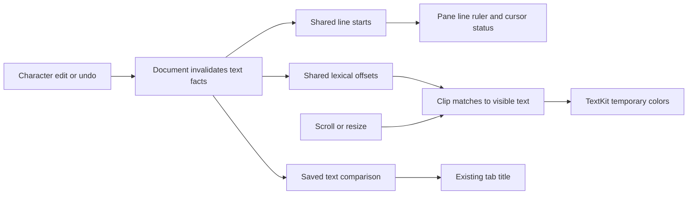

# Native editor performance optimization

[中文](performance-optimization.zh-CN.md)

Performance investigations use the actual Swift/AppKit implementation in an isolated test application. Measurements and fixture files stay in ignored `.build/performance/` directories. Existing editor instances and unsaved user documents are preserved. This report covers macOS; Windows performance is unmeasured.

For 0.9.1 display-style ownership and multi-file A/B results, see [presentation performance](presentation-performance.md). For 0.9.0 recovery queue behavior, bounded write timings and current open/edit/lifecycle measurements, see [the draft resource report](release-090-performance.md). The older optimization results below retain their original workload and version scope.

## Workloads and measurement limits

The opt-in runner creates a fresh GUI process for each case, at a fixed 1220 by 810 window size. Files repeat a source line containing ASCII, Chinese characters and an emoji. The default cases are 64 KiB, 1 MiB and 4 MiB file opens, plus four cycles of eight distinct 256 KiB files, both with and without retained undo history. Each file workload reads/decodes storage, opens a native pane, moves the caret to EOF, edits and undoes, scrolls twenty times, verifies EOF visibility, closes, then reopens the same file.

The runner records operation wall and CPU time, cumulative process CPU, resident memory, physical footprint, RSS high water, and maximum delay of a 20 ms main-thread heartbeat. Weak references independently check document, storage, view and layout-manager destruction after closing each cycle. Inactive documents should have no attached layout managers. Persistent fixture text is created before the empty-window snapshot, so absolute process memory includes it; window-relative deltas exclude this fixture allocation.

Scrolling is programmatic viewport movement followed by layout/display and event-loop pumping. It does not measure actual trackpad inertia, wheel event latency, GPU presentation or dropped frames. Wall time to the settled snapshot includes the fixed waiting interval; it is not an input-to-first-frame measurement. Fresh-process and same-process reopen are reported separately. Filesystem caches are not flushed, and the explicit storage read precedes native open. These are warm-filesystem GUI measurements, not cold-disk benchmarks. Shared WindowServer memory and unrelated processes are excluded; the supervised workload starts no subprocesses, so editor process and process-family measurements coincide.

## Confirmed bottlenecks and changes

The governing rule is to compute text facts at the document boundary and presentation work at the visible pane boundary. Closing the document also releases its caches; changing fonts or scrolling does not invalidate text facts. The changes add small offset arrays to avoid repeated text copies and whole-document presentation work.

| Operation | Former work | Current work and cost |
| --- | --- | --- |
| Cursor status | Copy UTF16 and scan the document prefix on every query | Build line starts once per character edit; binary-search the line and scan its prefix |
| Split-view line numbers | Each ruler owns a duplicate line index | All rulers consume the same document index; storage grows with line count |
| Dirty title | Recompare saved text during repeated status updates and recreate tabs | Cache exact comparison until text changes; update the existing changed tab |
| Open and scroll | Force TextKit layout for the entire document | Lay out requested regions; newly visited text incurs layout and may refine scrollbar extent |
| Syntax presentation | Paint whole-file regex ranges through TextKit | Cache lexical offsets per text/syntax state and paint clipped visible intersections |
| Indentation detection | Materialize all lines and scan unneeded characters | Scan 4096-unit UTF16 chunks and materialize only indented lines |



The former caret query copied all UTF16 units and scanned from the start for every status update. Dirty status compared the whole saved document repeatedly. Line rulers independently rebuilt the same index in each split pane. Documents now own one offsets-only logical line index and a dirty-text result; the text-storage delegate invalidates them on character edits, including native undo and recovery. Font and paragraph changes do not invalidate text facts. Status queries binary-search the line then count only its prefix. CR/LF/CRLF, a cursor between CR and LF, tabs, Unicode scalars, surrogate boundaries and exact saved bytes retain their previous semantics.

Pane initialization and every scroll-view layout formerly forced full-document TextKit layout. Panes now enable noncontiguous layout; the scroll view owns viewport width and minimum height, while TextKit owns document extent and estimates unlaid text. Opening no longer pays for all glyphs and line fragments in advance. First visits to unlaid text still do layout work, and scrollbar extent can adjust as estimates become precise.

A bounded one-second sample of the first layout optimization still found most sampled main-thread work inside lexical highlighting: 530 of 603 samples were in regex match callbacks, including 433 in `addTemporaryAttribute` and 349 in display invalidation. The replacement caches whole-file lexical ranges once per document text/syntax state, preserving multiline comment context. Panes binary-search these ranges and paint only matches intersecting the viewport plus a 2048-unit margin. Patterns and overlay order are retained. The existing 2,000,000 UTF16-unit lexical limit remains; larger files use plain text presentation. Cache values retain offsets, never views or a second text snapshot, and are released with the document.

Intersections are clipped before painting: a comment spanning the entire file must not pass its full extent to TextKit display invalidation. Scrolling replaces previously painted viewport ranges and skips unchanged ranges; edits clear invalidated temporary presentation once. An additional 1 MiB whole-file block-comment workload verifies the actual native temporary color at the beginning and across twenty viewport moves, including edit/undo and EOF visibility.

Indentation detection streams newline-delimited slices without allocating every line or counting all nonindented line characters. Changed-file notifications update the existing tab label; document ordering and selection still rebuild tabs when necessary. These changes preserve the existing context-menu document identities.

## Measured before and after

Measured on 2026-10-24, macOS 14.2.1 / Apple Silicon, Swift 5.10, optimized builds. Baseline production sources come from commit `4c4092d`; only test dispatch is added. Final sources are the macOS 0.6.1 implementation. `baseline-v3` and `final` retain file workload results; `baseline-v2` retains the equivalent four-cycle multiple/undo workloads. Fixture hashes match. The final test driver adds color assertions and a cycle-count option; the default operation sequence and four-cycle file count are unchanged. Values below are individual completed runs, not distributions or promises for all files.

| File size | Native open before → after (ms) | Same-process reopen before → after (ms) | Main heartbeat maximum before → after (ms) |
| --- | --- | --- | --- |
| 64 KiB | 381 → 168 | 110 → 57 | 501 → 249 |
| 1 MiB | 1,859 → 138 | 1,820 → 130 | 2,361 → 182 |
| 4 MiB | 14,522 → 374 | 14,385 → 372 | 16,492 → 472 |

| 4 MiB workload metric | Before | After |
| --- | --- | --- |
| Read/decode/storage wall time | 388 ms | 297 ms |
| Caret at EOF | 419 ms | 0.85 ms |
| Native edit at EOF | 918 ms | 24.91 ms |
| Native undo | 1,320 ms | 40.57 ms |
| Open-settled physical footprint | 113.64 MiB | 61.96 MiB |
| Process RSS high water | 211.27 MiB | 143.95 MiB |
| Completed process CPU time | 37.41 s | 2.45 s |
| Completed supervised wall time | 40.33 s | 5.79 s |

For the 1 MiB workload, open-settled footprint decreased from 103.47 to 68.61 MiB, RSS high water from 149.53 to 122.25 MiB, and completed CPU from 7.59 to 1.81 s. The 64 KiB RSS high water increased slightly, from 92.44 to 93.95 MiB; its footprint peak also increased. Small-file and cycling graphics peaks do not uniformly improve.

| Programmatic scrolling | Before first / repeat median (ms) | After first / repeat median (ms) | After maximum (ms) |
| --- | --- | --- | --- |
| 64 KiB | 0.29 / 0.29 | 5.65 / 0.23 | 6.43 |
| 1 MiB | 0.25 / 0.27 | 14.82 / 2.36 | 22.08 |
| 4 MiB | 0.27 / 0.29 | 48.77 / 4.67 | 51.66 |

The baseline paid for complete layout before scrolling. The optimized first pass pays for previously unlaid regions; the repeat pass revisits fractional document positions after ten moves. TextKit's extent estimates can change, so the second pass is not a guarantee of identical character ranges or entirely warm layout. Far viewport jumps still exceed a 16.7 ms frame budget. Actual wheel/inertia/GPU performance remains unmeasured. The whole-file block-comment case opened in 149 ms, with a 198 ms maximum heartbeat delay and all native color checks passing.

Four-cycle multiple-file workloads completed in 46.91 → 10.84 s (43.08 → 6.62 s CPU) without undo history, and 57.12 → 11.49 s (52.61 → 6.22 s CPU) with it. Heartbeat maxima decreased from 7.90 / 9.08 s to 1.08 / 1.15 s. Each open/switch/close batch processes eight files without yielding; these maxima are batch stalls, not the latency of one user tab click. All probed closed objects were released and only the current document had an attached layout manager after opening eight files.

The final `lifetime-final` run extends both cases to twelve cycles in one process, or 96 distinct files per case. All tracked closed document, storage, view and layout weak references were nil after every cycle. Normal-case closed footprint rose during initial warming, then ranged from 82.22 to 92.92 MiB in cycles 7–12, finishing at 82.22 MiB and dropping to 67.75 MiB after window close. The undo case ranged from 64.11 to 68.82 MiB over cycles 7–12. Neither final tail shows persistent growth. These probes found no leak in the tested file lifecycle; they are not a complete heap census or proof about untested workloads.

An initial scalar-based streaming indentation implementation regressed read/decode/storage by about 30% (4 MiB: 388 → 502 ms). It was replaced with chunked UTF16 scanning; the final result is 297 ms. This rejected intermediate implementation is not part of the final source.

## Reproduce

From the editor root, use a source checkout or source package exported with `--with-tests`, in a logged-in macOS GUI session:

```sh
python3 tests/run_performance.py before
# After a change, the runner builds and pins another test bundle.
python3 tests/run_performance.py after
# A bounded subset using an already compiled test application:
python3 tests/run_performance.py focused --no-build --cases file:1048576 multiple:262144
# Longer same-process lifetime check: 96 distinct files per case.
python3 tests/run_performance.py lifetime --no-build --cycles 12 --cases multiple:262144 undo:262144
# Native clipping/color validation for a comment spanning the entire file:
python3 tests/run_performance.py comment --no-build --cases comment:1048576
```

Each run requires a new name and retains its pinned bundle, compiler/platform information, source and binary hashes, raw output, per-case `metrics.json` and aggregate `manifest.json`. `--binary` reuses a pinned bundle; `--source-root` identifies its corresponding source tree for provenance. A 90-second case timeout and 1536 MiB sampled RSS limit stop only the owned process group, retaining a bounded stack sample. Performance workloads are separate from ordinary acceptance tests and are not shipped in the release binary.

## Remaining costs

Open still reads, strictly decodes, detects indentation and hashes the file synchronously. Text edits rebuild the line index on demand and, below the lexical limit, rescan lexical patterns. Whole-document commands and undo snapshots can retain additional text while the file remains open. Very long single lines still require scanning their prefix for the visual column. Repeated visits can retain TextKit glyphs, font fallback data and graphics allocations. A high retained RSS alone does not establish an application object leak. Real wheel/IME latency, very large or pathological regex inputs, prolonged sessions, physical Intel GUI and Windows require additional workloads.

See [package and memory analysis](package-and-memory.md) for an additional measurement of the unchanged release binary, memory accounting definitions and the installed application inventory. [Performance index](../PERFORMANCE.md).
