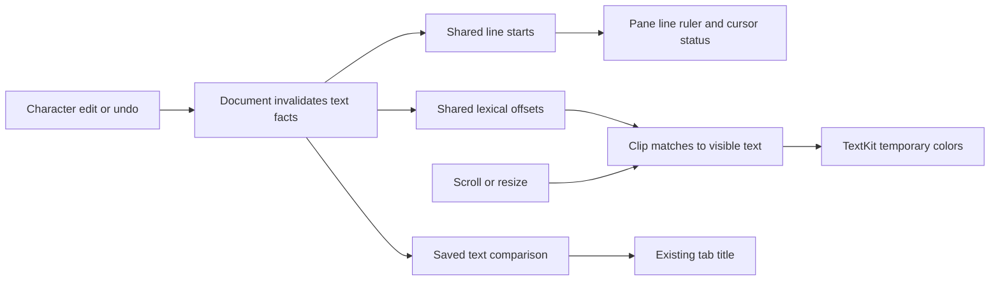

# 原生编辑器性能优化

[English](performance-optimization.md)

调查使用实际 Swift/AppKit 源码和隔离测试应用，证据/fixture 保存在忽略的 `.build/performance/`。保留用户应用和未保存内容。本文仅覆盖 macOS，Windows 性能未测。

0.9.1 样式共享与多文件 A/B 见 [显示性能](presentation-performance.zh-CN.md)，0.9.0 草稿队列和资源见 [草稿报告](release-090-performance.zh-CN.md)。下方保留原版本及工作负载的历史结果。

## 工作负载与口径

每个案例启动新的 GUI 进程，窗口 1220×810。fixture 重复包含 ASCII、中文和 emoji 的代码行。默认打开 64 KiB、1 MiB、4 MiB 文件，并执行四轮八个不同 256 KiB 文件，分别保留/不保留撤销历史。每个文件读入解码、打开 pane、定位 EOF、编辑/撤销、滚动二十次、检查 EOF、关闭并重开。

记录操作 elapsed/CPU、累计进程 CPU、RSS、physical footprint、高水位与 20 ms 主队列 heartbeat 最大延迟；弱引用独立检查文档、storage、视图与 layout manager 释放。非活动文档不应挂 layout manager。fixture 在空窗口快照前创建，绝对内存包含它，窗口相对差值不包含。

滚动为程序移动、布局/显示与事件循环，不是触控板惯性、滚轮输入延迟、GPU 或掉帧。稳定快照耗时含固定等待，不是输入到首帧。首次/同进程重开分开报告；文件系统缓存未清空，显式读取早于 native open，因此是暖文件系统 GUI 测量。WindowServer/其他进程不纳入；工作负载无子进程，自有进程与进程族一致。

## 瓶颈与结构修正

文本事实由文档计算，展示工作由可见 pane 负责。关闭释放缓存；字体/滚动不使文本事实失效。用小型 offset 数组避免全文复制与重复展示。

| 操作 | 原工作 | 当前工作与成本 |
| --- | --- | --- |
| 光标状态 | 每次复制 UTF16 并扫描全文前缀 | 编辑后构建行索引，二分定位并扫描行前缀 |
| 拆分行号 | 各 ruler 拥有重复索引 | 共享文档索引，容量随行数增长 |
| 修改状态标题 | 重复比较已保存文本并重建标签 | 编辑前复用精确比较，只更新变化标签 |
| 打开与滚动 | 强制 TextKit 全文布局 | 按需布局；新区域产生布局并更新范围估算 |
| 语法展示 | 绘制全文正则范围 | 按文本/语法缓存 offsets，仅绘制视口交集 |
| 缩进检测 | 实体化所有行并扫描不必要字符 | 分块扫描 4096 UTF16，仅实体化缩进行 |



原光标状态每次复制全文 UTF-16 并扫描前缀；脏状态反复比较已保存文本；拆分 ruler 重建重复索引。现在文档拥有一份行 offset 和脏状态缓存，字符编辑/原生撤销/恢复使其失效，字体段落变化不会。行号二分搜索后只扫描本行前缀。CR/LF/CRLF、CR 与 LF 之间位置、Tab、Unicode、代理边界和精确保存语义保留。

原 pane 初始化/滚动布局强制全文 TextKit 布局。现在启用非连续布局：滚动视图拥有视口宽度/最小高度，TextKit 估算未布局区。首次访问新区域仍要布局，滚动条范围可能随估算更新。

首次布局优化的一秒采样中，603 次主线程样本有 530 次落在正则回调，433 次 `addTemporaryAttribute`、349 次显示失效。最终按文档文本/语法缓存全文词法 offsets，保持跨行注释上下文；pane 二分筛选视口加 2048 单位边距，只绘制交集，保持模式与覆盖顺序。原 2,000,000 UTF-16 单位阈值不变，更大文件按纯文本显示。缓存只持 offsets，不持视图或第二份全文，随文档释放。

绘制前裁剪交集，整文件注释不能让 TextKit 按全文范围失效。滚动替换旧视口颜色并跳过未变化范围；编辑清理失效展示。额外 1 MiB 全文件块注释案例检查开始、二十次滚动、编辑/撤销和 EOF 的真实临时颜色。

缩进检测按行流式扫描，避免为每行分配或扫描所有未缩进行字符。文件变化更新既有标签；顺序/选择变化仍在需要时重建。右键菜单文档身份保持不变。

## 前后实测

2026-10-24，macOS 14.2.1、Apple Silicon、Swift 5.10、优化构建。基线为 `4c4092d` 加测试入口，最终为 0.6.1。`baseline-v3`/`final` 保留文件工作负载，`baseline-v2` 保留相同四轮多文件/撤销负载；fixture 摘要一致。最终驱动新增颜色断言与轮数选项，默认操作与文件数不变。每项是完成的一次运行，不是分布或所有文件的保证。

| 文件大小 | 打开前 → 后 (ms) | 同进程重开前 → 后 (ms) | heartbeat 最大前 → 后 (ms) |
| --- | --- | --- | --- |
| 64 KiB | 381 → 168 | 110 → 57 | 501 → 249 |
| 1 MiB | 1,859 → 138 | 1,820 → 130 | 2,361 → 182 |
| 4 MiB | 14,522 → 374 | 14,385 → 372 | 16,492 → 472 |

| 4 MiB 指标 | 优化前 | 优化后 |
| --- | --- | --- |
| 读取/解码/storage elapsed | 388 ms | 297 ms |
| EOF 光标 | 419 ms | 0.85 ms |
| EOF 编辑 | 918 ms | 24.91 ms |
| 原生撤销 | 1,320 ms | 40.57 ms |
| 稳定后 footprint | 113.64 MiB | 61.96 MiB |
| 进程 RSS 高水位 | 211.27 MiB | 143.95 MiB |
| 完整 CPU | 37.41 s | 2.45 s |
| 完整任务 elapsed | 40.33 s | 5.79 s |

1 MiB 的稳定 footprint 从 103.47→68.61 MiB，RSS 高水位 149.53→122.25 MiB，完整 CPU 7.59→1.81 s。64 KiB RSS 高水位反而从 92.44→93.95 MiB，footprint 峰值也增加；小文件及图形峰值并非统一改善。

| 程序滚动 | 优化前 首次/重复中位数 (ms) | 优化后 首次/重复中位数 (ms) | 优化后最大 (ms) |
| --- | --- | --- | --- |
| 64 KiB | 0.29 / 0.29 | 5.65 / 0.23 | 6.43 |
| 1 MiB | 0.25 / 0.27 | 14.82 / 2.36 | 22.08 |
| 4 MiB | 0.27 / 0.29 | 48.77 / 4.67 | 51.66 |

基线预付全文布局，所以滚动很快；优化后的首次滚动承担新区域布局，重复阶段在十次后重访比例位置。TextKit 范围估算可能改变，重复并不保证同一字符区或完全暖布局。远距离跳转仍可能超过 16.7 ms 帧预算；真实滚轮/GPU 未测。全文件注释案例 native open 149 ms，最大 heartbeat 198 ms，颜色检查均通过。

四轮多文件无撤销总耗时 46.91→10.84 s，CPU 43.08→6.62 s；有撤销 57.12→11.49 s，CPU 52.61→6.22 s。heartbeat 7.90/9.08 s→1.08/1.15 s。每批连续处理八文件而不让出主队列，是批量停顿而非一次用户点击延迟。关闭对象释放，仅活动文档挂 layout manager。

`lifetime-final` 各跑十二轮/96 个不同文档。每轮关闭 document/storage/view/layout 弱引用为 nil。普通案例第 7–12 轮 footprint 82.22–92.92 MiB，最终 82.22、窗口关闭后 67.75 MiB；撤销案例尾部 64.11–68.82 MiB，无持续增长。仅说明已测路径未发现泄漏，不是全堆或所有工作负载证明。

最初按 Unicode scalar 流式检测使 4 MiB 读入从 388→502 ms，约回退 30%；被分块 UTF-16 方案替换，最终 297 ms。回退方案不在最终源码。

## 重跑

从编辑器根目录，在 macOS 图形会话使用包含测试的源码：

```sh
python3 tests/run_performance.py before
# After a change, the runner builds and pins another test bundle.
python3 tests/run_performance.py after
# A bounded subset using an already compiled test application:
python3 tests/run_performance.py focused --no-build --cases file:1048576 multiple:262144
# Longer same-process lifetime check: 96 distinct files per case.
python3 tests/run_performance.py lifetime --no-build --cycles 12 --cases multiple:262144 undo:262144
# Native clipping/color validation for a comment spanning the entire file:
python3 tests/run_performance.py comment --no-build --cases comment:1048576
```

每次用新名称，保存固定应用、平台/编译器、源码/程序摘要、原始输出、每案 metrics.json 和 manifest.json。`--binary` 复用固定包，`--source-root` 指明对应源码。90 秒超时/1536 MiB 采样 RSS 上限仅停止自有进程组，并保留有限栈采样。基准不进入发行程序。

## 剩余成本

打开仍同步读取、严格解码、缩进检测和 SHA-256。编辑按需重建行索引，在词法阈值内重新扫描；全文命令/撤销可能保留更多文本。超长单行仍需扫描列前缀。TextKit、字体回退、图形缓存可能保留内存，RSS 不下降不能独立证明对象泄漏。真实滚轮/IME、病态正则、更大文件、长期工作、物理 Intel 和 Windows 需新负载。

[包与内存](package-and-memory.zh-CN.md) 说明同一发行程序的内存口径和安装清单；[性能导航](../PERFORMANCE.zh-CN.md)。
